# Induction Hardware competitive analysis and BFCM scale plan

## Induction Hardware

Competitive analysis and November BFCM scale plan | Macrine Jangu | Review draft | 26 October 2026

### Executive summary

I would approve a $150,000 November ceiling, then ask each increase to earn its place. The aim is profitable growth from the brief's approximate $50,000 monthly baseline. If the evidence supports $110,000 or less, I would finish there. We have no account results yet, so committing to the full amount now would get ahead of what we know.

November maximum | Google | Meta
--- | --- | ---
$150,000 | $90,000 / 60% | $60,000 / 40%

I would start with $90,000 for Google and $60,000 for Meta. A buyer searching for a specific range width is giving us a useful clue about what they need. Meta gives us room to show the cooking experience, answer questions and follow up with interested buyers. I would revisit the split against actual contribution. Microsoft gets no initial budget. Production and software need separate funding.

### Three findings driving the plan

Three observations shape the plan.
1. The October sale display and help answer disagree. I would fix the offer before paying to send more people into a confusing journey. E38-E40.
2. The Shopping snapshot contains a sponsored retailer listing and a mix of product types. I would keep a buyer looking for a complete range away from a rangetop page. E26.
3. Design, cooking demonstrations and showroom invitations recur in the sample. I would test those approaches, then connect qualified enquiries to actual orders. META-FP-002, META-THERMADOR-004, META-WOLF-007.

### Three risks controlling release

The extra $100,000 becomes waste if we fund products with weak contribution, count the same sale twice, or generate enquiries the team cannot fulfill. My first review would bring finance, analytics and operations together to check those risks. None of the execution checks is passed in this hypothetical exercise.

The public evidence tells me what was visible on the capture date. The budgets, thresholds and forecasts below are my proposals. November ends on Cyber Monday, November 30. I have kept December 1-7 separate, with a proposed $10,000 ceiling. The October sale does not give us permission to extend the same offer into November.

## Part 1. Competitive set

Keep the current six-company selection. Earlier Codex research provides supplemental evidence.

Competitor | Why selected | Boundary
--- | --- | ---
Fisher & Paykel | Premium anchor for large-format induction and suite design. | E22 confirms range selection. Broad brand ads are not induction-only.
Wolf | Luxury performance and showroom acquisition benchmark. | META-WOLF sample includes Sub-Zero and Cove categories.
Thermador | Premium technology, design and kitchen-suite pressure. | Heritage and creator examples are not verified induction campaigns.
ZLINE | Challenger with induction products and lower sampled 48 inch MSRP. | Manufacturer site observed. DTC checkout remains unverified.
ILVE | Design competitor with distinctive finishes and 48 inch retail listings. | Five visible Meta cards reviewed, not six unique confirmed creatives.
AJ Madison | Retailer comparing large-format ranges, prices and offers. | Retail category evidence establishes assortment, not paid keyword overlap.

I chose a set covering premium products, a challenger and a retailer. Bosch, Miele, Viking, AGA and Samsung stay on the monitoring list because adding them would repeat several comparisons. That does not mean they are absent from auctions. Sources: competitors.csv, COMP-004 to COMP-010, E22, E47 and the six advertiser screenshot groups.

Earlier research also covered Fulgor Milano, Cafe and Best Buy. I kept their evidence where it answers a useful question about products, delivery or Google. The main comparison still uses the current six competitors, so the extra research supports the argument without changing the scope halfway through.

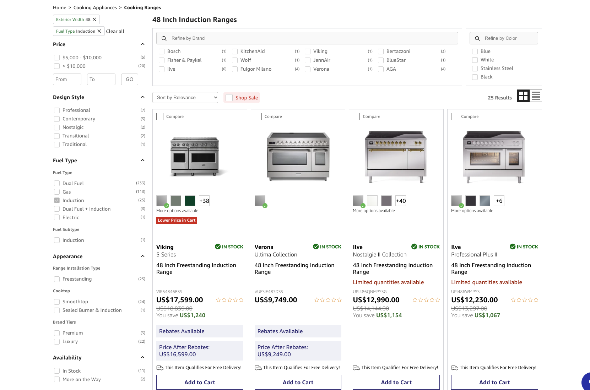

## Part 1. Meta sample and longevity

United States advertiser views. Counts describe dated library results, not spend, reach or unique concepts.

Advertiser | Capture and count | Oldest reviewed start | Formats, hooks and offers
--- | --- | --- | ---
ZLINE | Oct 25 / 150 reported | Sep 15 / 40 days | Image, video, carousel. Professional design, education and savings. Hood offer differs from range offer.
Fisher & Paykel | Oct 25 / 12 reported | Jul 20 / 97 days | Video and image. Premium kitchen and brand story. No explicit discount in reviewed Meta cards.
Wolf group | Oct 25 / 300 reported | Jun 29 / 118 days | Image, video, carousel. Showroom booking and premium cooking across group products.
Thermador | Oct 25 / 48 reported | Aug 21 / 65 days | Image and video. Heritage, design, cooking creators and kitchen suite.
ILVE | Oct 25 / about 6 results | Sep 24 / 31 days | Five visible active cards. Carousel and video. Italian design, finishes and creator association.
AJ Madison | Oct 26 / 3 reported | Aug 27 / 60 days | Product images. Two up-to savings offers. None of the three is induction-specific.

I use the displayed start date as a clue about which messages deserve a closer look. It does not tell me an ad ran continuously or made money. The two ZLINE captures show about 140 and 150 page results. I have kept both dated views rather than turn them into a precise count of unique ideas.

The sample includes recent October starts for ZLINE, Fisher & Paykel, Wolf, Thermador and AJ Madison. I did not establish a verified 2025 BFCM example in the saved All status views. I would spend more research time there before drawing a seasonal conclusion. Current October copy does not tell us what worked last Black Friday.

Evidence: research/meta/meta-audit.csv and META-ZLINE-001/002/008, META-FP-001/002, META-WOLF-003/009, META-THERMADOR-001/004, META-ILVE-001, META-AJM-001. These are sampled cards, not a full video review or recovered creator brief.

## Part 1. Premium storytelling

Original user screenshots inline. Open the combined evidence gallery for full-resolution images and source URLs.

### Fisher & Paykel

Premium kitchen video. The oldest reviewed start is July 20. Test a real cooking demonstration against kitchen design, holding offer constant.

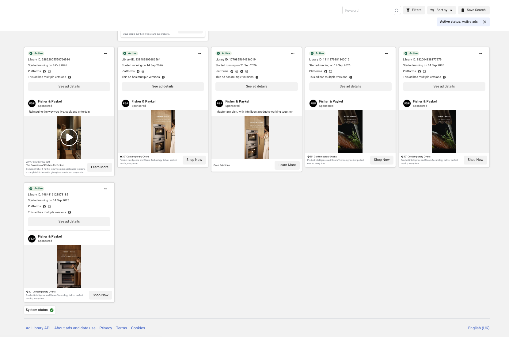

### Wolf showroom route

Location-specific consultation creative repeats across locations. Test a staffed adviser route. Repeated versions do not establish independent creative winners.

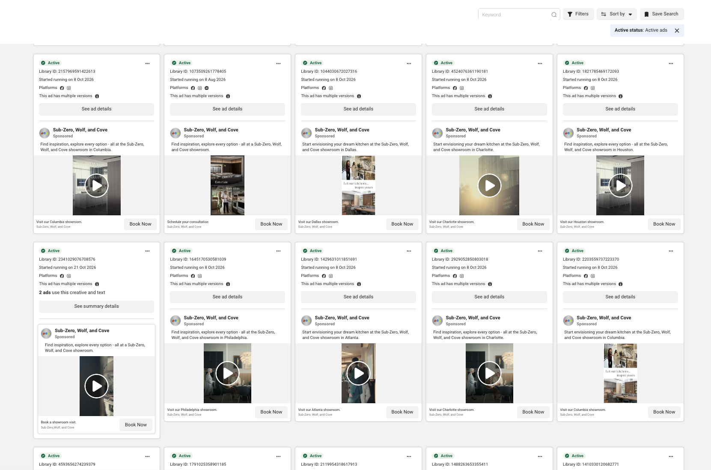

## Part 1. Challenger and creator angles

Original user screenshots inline. Open the combined evidence gallery for full-resolution images and source URLs.

### ZLINE

Creator-associated Carnie Wilson example alongside product advertising. Brief genuine product experience and secure usage rights. Full video playback remains incomplete.

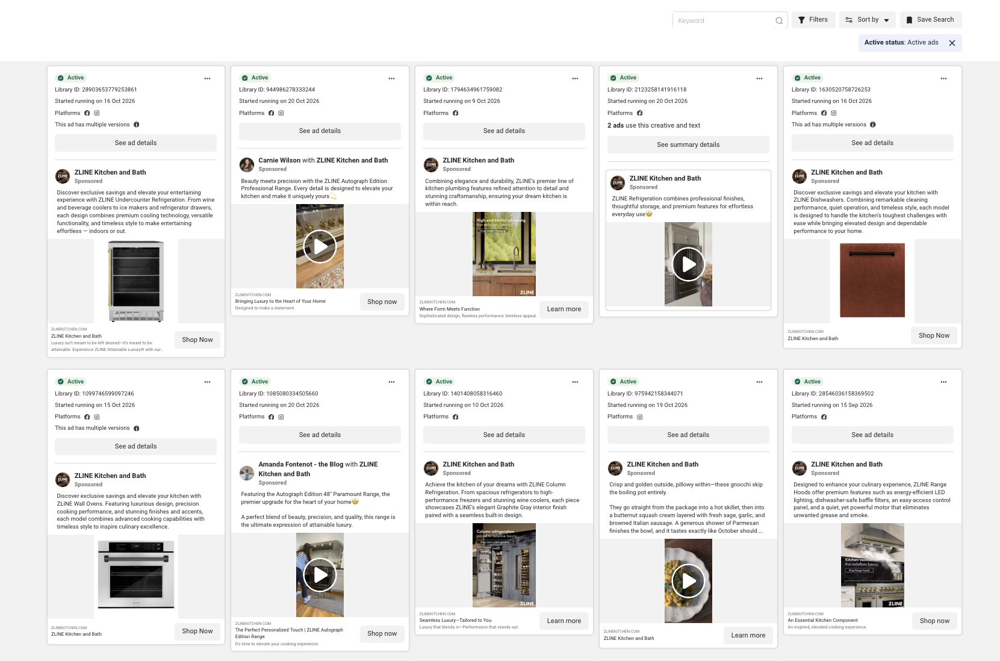

### Thermador

Heritage, distinctive product design and creator-associated cooking. Test practical cooking proof. No assumed creator production brief or performance.

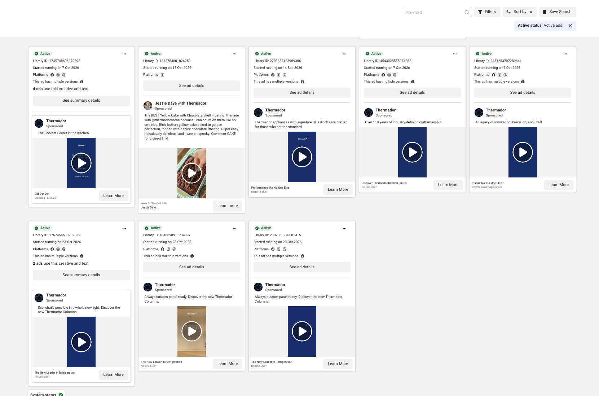

## Part 1. Design and retail pressure

Original user screenshots inline. Open the combined evidence gallery for full-resolution images and source URLs.

### ILVE

Five reviewed cards emphasize Italian design, Majestic III and finishes. Test finish-led kitchen creative. Internal creative process and clicked landing experience remain unknown.

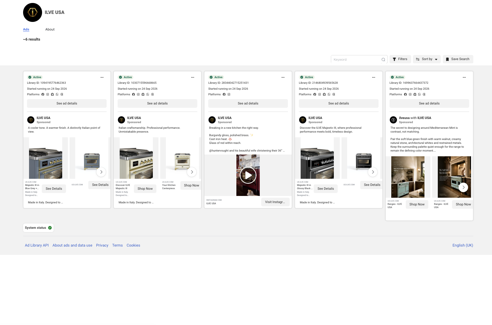

### AJ Madison

Three visible active cards. Closeout and flash-sale offers apply to other product categories. Test only a client-approved range offer, without borrowing unrelated discount depth.

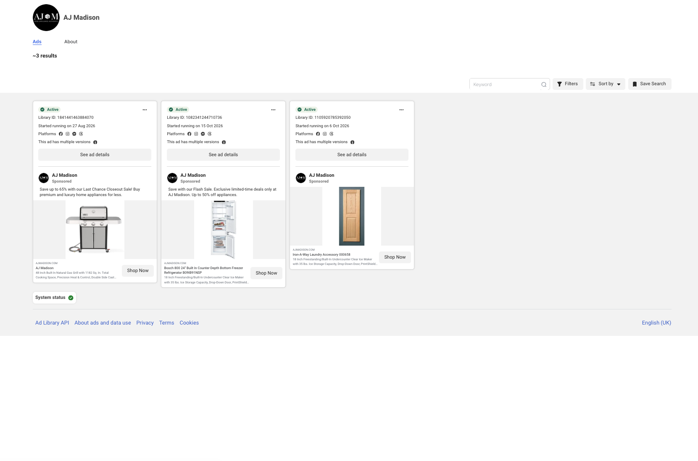

## Part 1. What Google evidence establishes

Historical capture checked against original screenshots and paired text on 26 October 2026.

Domain | Displayed inventory | Meaning and limit
--- | --- | ---
fisherpaykel.com | 65 / E07 | US domain inventory. Selected text ad is a refrigerator, E32.
zlinekitchen.com | About 900 / E13 | US domain inventory. Selected text ad is a range hood, E41.
cafeappliances.com | About 400 / E14 | Broad appliance inventory. Supplemental competitor only.
fulgor-milano.com | 0 returned / E16 | This domain and filter result only. Retailer activity and other domains remain possible.
bestbuy.com | About 8k / E19 | Broad retailer categories. Not 8k appliance or induction ads.

Google Transparency helps establish advertiser activity. I used US region, Any time, all platforms and all formats. Those settings return broad inventories across products and sometimes advertiser accounts. They do not tell me the keywords, spend or returns behind a campaign.

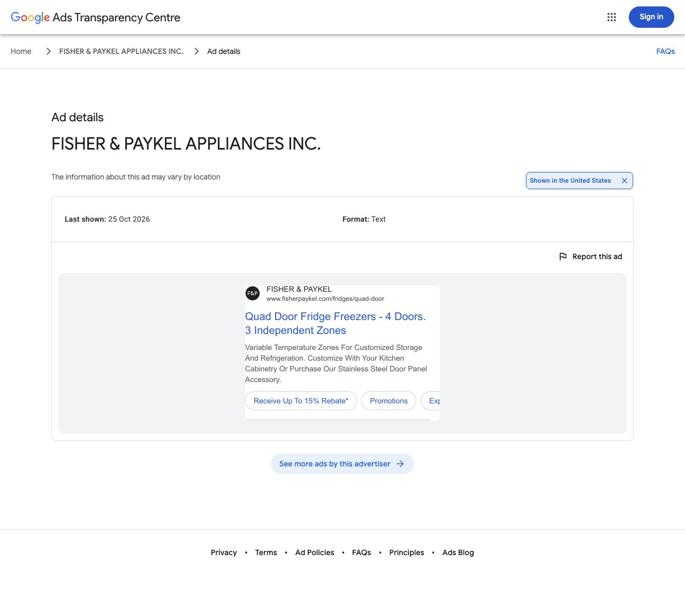

A closer look matters here. E32 is a Fisher & Paykel refrigerator ad. E41 is a ZLINE hood ad. Both were last shown on October 25, but neither establishes bidding on induction-range terms. I would use them to understand advertiser presence, then seek query-level evidence before making an auction claim.

## Part 1. Search and Shopping overlap

Four requested search intents, one dated mixed-location session. No controlled US auction study.

Query | What was observed | Funding implication
--- | --- | ---
induction range | E15 product modules and organic context. No sponsored text placement for the current six verified. | Tightly controlled nonbrand intent with product-type review.
48 inch induction range | E17 product results. E26 Sponsored Products includes Best Buy selling a Fisher & Paykel range. | Prioritize eligible width-specific product path and clean feed.
induction vs gas | E43 AI, editorial, forum and video context. No competitor sponsored text placement verified. | Cap research cell inside the $30,000 nonbrand allocation.
Induction Hardware | E23 official site and other results. No competitor sponsored brand placement verified. | Separate brand budget. No invented conquesting threat.

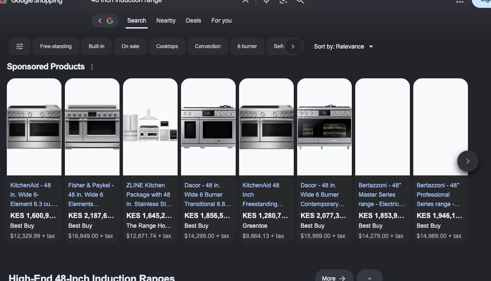

I set US search parameters, yet the Shopping page still displayed Kenyan currency. That limits what I would say about the result. The sponsored Best Buy card is visible, but this is not a controlled US auction study. I have kept the original ten query themes and added the required brand and gas-comparison queries. Unsampled terms stay unverified.

Width-specific searches, honest product comparisons and fit questions look worth testing. I would check demand and buying quality before increasing their budgets. No Keyword Planner, Semrush, Ahrefs or Auction Insights report was run, so there is no verified CPC, search volume or keyword-gap score behind this recommendation.

## Part 1. Product value and buying friction

Displayed USD prices from 25 October 2026. Configuration, availability and delivered totals need rechecking.

Product | Displayed price | Source and boundary
--- | --- | ---
IH 48 inch Luxury starting price | $7,599.95 | E40 / COMP-001. Starting variant, before verified checkout redemption.
Fisher & Paykel 48 inch RIV3-486 | $16,849 | E22. Selected collection model. Delivery and configuration differ.
ZLINE SINR48 | $6,999.99 | E47. Manufacturer MSRP, not completed transaction.
Fulgor F6PIR485GS1 | $17,599 | E17 / E26 merchant result. Supplemental premium reference.

I see room for a specific value argument, rather than a claim to be the cheapest. The sampled ZLINE price is lower than IH's starting price. Before publishing a comparison, I would match the model, oven configuration, finish, accessories, warranty and delivered cost. A rangetop without an oven belongs in a different comparison.

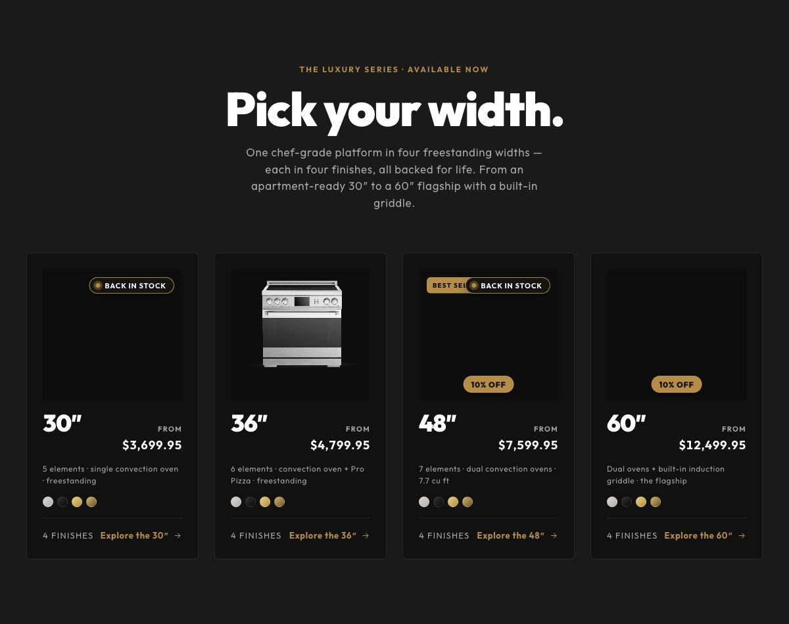

The October offer is a useful execution warning. The brief, pop-up and collection describe 10% on eligible 48 and 60 inch Luxury ranges through October 31, while the help answer says no promotions. I verified the conflicting messages, not a redeemed code. Commerce needs to approve one November offer and make every part of the journey agree.

A buyer should not need to guess what a warranty or finance headline covers. I would check parts, labour, service coverage and eligibility before using those claims in ads. The same applies to household rebates. I have not assumed every model or buyer qualifies.

## Part 1. Landing and offer teardown

Observed destinations and unknown clicked paths stay separate.

Path | Observed or reported | Action and missing check
--- | --- | ---
Induction Hardware | Conflicting offer displays; up to 24 months 0% APR is a site claim Curbside excludes final installation and haul-away; verify model requirements | Use one approved offer, show exclusions and model-specific fit beside purchase Sources: E38 E39 E40 COMP-003.
Fisher & Paykel | Up to 15% prepaid-card rebate with qualifying terms; financing not verified Delivered total and installation pending | Borrow eligibility clarity; no instant discount or equivalent warranty claim Sources: E08 E22.
Wolf | No explicit savings visible in sampled ads; finance unverified Final clicked destination and delivery terms not verified | Test staffed adviser path; competitor landing experience remains unverified Sources: META-WOLF-007 META-WOLF-009.
Thermador | No percentage offer visible in sampled cards; finance unverified Clicked destination and final installation path not verified | Test demonstration and reassurance; no invented financing comparison Sources: META-THERMADOR-001 META-THERMADOR-004.
ZLINE | Model MSRP visible; Bundle Builder navigation; final finance terms unverified Shipping calculated at checkout; final install quote unverified | Use complete-range and finish navigation; no verified DTC transaction claim Sources: E09 E47 COMP-004.
ILVE | No percentage offer visible in five reviewed cards; finance unverified Clicked destination, shipping and installation not verified | Test finish story; do not score unvisited checkout Sources: META-ILVE-001.
AJ Madison | Prices, rebates and bundles visible; Meta savings apply to other products Delivery and installation quotes not checked in user sample | Compare exact SKU and delivered terms before any value claim Sources: COMP-008 COMP-009 COMP-010 META-AJM-001.

The advice route matters as much as the page. IH's support information appears in E39 and the brief. Wolf's Book Now cards show consultation intent. ZLINE has dealer and support navigation. I have not verified every final call route, clicked destination or service experience, and would not score those gaps as competitor weaknesses.

For our own buying path, I would make the next step easier: open the right width and product type, explain model-specific fit and power requirements, state delivery boundaries and give the buyer a staffed advice route. A power rating from one model should never become a promise about the full range.

## Part 1. Eight findings into funded decisions

Evidence supplies hypotheses. Client outcomes decide whether those hypotheses earn more budget.

Finding | Evidence | Action in Part 2
--- | --- | ---
F1 Offer conflict across sale popup, collection and help answer | E38 E39 E40 COMP-001 | Reconcile one signed offer record before promotional launch
F2 Premium price gap exists but ZLINE undercuts sampled IH price | E22 E26 E40 E47 | Test model-specific value on a stocked 48 inch range
F3 Sponsored Shopping contains mixed product types | E26 | Separate complete ranges from rangetops and segment eligible widths
F4 Premium lifestyle and distinctive design recur across current six | META-FP-002 META-ILVE-001 META-THERMADOR-004 | Compare cooking proof, finish-led design and approved suite story
F5 Curbside delivery and fit require buyer clarity | E39 COMP-003 E10 | Publish model-specific fit checklist and delivery boundaries
F6 Creator-associated content appears in ZLINE and Thermador samples | META-ZLINE-002 META-THERMADOR-003 META-THERMADOR-004 | Brief real demonstrations and genuine owner stories with rights
F7 Wolf showroom CTAs and retailer paths show assisted journey options | META-WOLF-007 META-WOLF-009 E37 | Connect qualified enquiry, appointment and unique order ID
F8 Ad counts, longevity and Google inventories do not reveal returns | E07 E13 E16 E32 E41 META-ZLINE-001 META-AJM-001 | Release funding against mature contribution and capacity

The five original GOOGLE entries are useful retail and editorial context. They have no saved screenshots and do not prove paid placement. I kept them in the source file, then populated a separate audit with the archived Google captures. This lets the reviewer see which evidence supports which claim.

I do not need an invented competitor CAC or a supposed empty auction window to make this plan useful. The public evidence gives me sensible tests. Our own margin, sales and capacity would decide whether those tests deserve more money.

## Part 2. Phasing and funding releases

All phase totals are maximum allocations. Late clearance produces lower spend.

Window | Google | Meta | Total / average per day
--- | --- | --- | ---
Nov 1-7 | $9,000 | $6,000 | $15,000 / $2,143
Nov 8-14 | $15,000 | $10,000 | $25,000 / $3,571
Nov 15-25 | $27,000 | $18,000 | $45,000 / $4,091
Nov 26-30 | $39,000 | $26,000 | $65,000 / $13,000
November | $90,000 | $60,000 | $150,000
Dec 1-7, separate | $6,000 | $4,000 | $10,000 / $1,429

### Release sequence

I would clear economics, tracking, offers and stock before launch. The first-week review governs whether cumulative spend moves past $40,000. Before $75,000, finance and analytics need to approve contribution and reconciled sales. Operations then reconfirms peak stock and fulfillment on November 23. Each release gets a named owner, supporting evidence and a next review date.

The peak allowance is the part I would challenge hardest. Its $13,000 daily average is 3.18 times the preceding phase. That table is an upper limit, not a campaign instruction. I would keep the proposed 10-15% increases every 48-72 hours, check conversion lag and prepare capacity early. A late approval means less spend, not a rush to catch up.

### Under-ceiling outcome

If the commercial case holds but the evidence stays thin, I would cut the peak allowance from $65,000 to $25,000. November would then total $110,000: $66,000 Google and $44,000 Meta. That is another ceiling, not proof of profitability. Failed tracking, poor economics or unavailable stock would justify spending less again.

Early access would use consented audiences and signed-off terms. I would carry the same offer through ads, email, pages and support. After Cyber Monday, I would remove expired sale copy and focus on useful advice and closing existing enquiries. December's proposed budget needs its own approval.

## Part 2. Platform and campaign structure

Full-release caps. The table allocates the same $150,000, with no additional media funding.

Campaign | Cap | Structure and controls
--- | --- | ---
Google Brand Search | $9,000 | Brand. Exact and reviewed brand variants; isolated reporting
Google Nonbrand Search | $30,000 | Prospecting. Stocked widths and buying intent; USD 3000 research cell included
Google Standard Shopping | $18,000 | Prospecting. Complete ranges; mutually exclusive SKU set from PMax for diagnosis
Google Performance Max | $24,000 | Mixed automated inventory. Eligible stock and margin; validate brand controls; no guaranteed audience isolation
Google YouTube or Demand Gen | $9,000 | 6000 prospecting / 3000 warm. One format family first; hold funds if signal quality fails
Meta Prospecting Sales | $42,000 | Prospecting. Consolidate broad serviceable audience; eligible purchaser exclusions
Meta Warm Sales | $12,000 | Warm. Combine 7/30/90 day segments if volume is thin
Meta Creative tests | $6,000 | Prospecting tests. Four paired first-pass tests; included in Meta total

I would start by understanding what already works, then add as little fragmentation as the evidence allows. Search would begin with tightly reviewed brand, width and purchase intent. Negatives need context: a word worth excluding in one campaign might describe a useful comparison in another.

For the initial diagnosis, I would keep Standard Shopping and PMax on different eligible SKU sets. I would check available brand controls and report brand separately. PMax will not give us perfectly separate prospecting and warm audiences. If automation or video lacks useful signals, I would hold that money or move approved funds toward proven intent within the same ceiling.

I would optimize toward trustworthy purchase value. A qualified-lead route only earns a larger role once sales feedback shows which enquiries become customers. Page views and call clicks help diagnose the journey, but they do not pay for media. I would review channel shifts weekly and reduce total spend if both channels are failing.

## Part 2. Economics and scaling rules

Illustrative thresholds until finance and account history replace them.

I would ask finance a practical question: after the product, discount, freight, fees and expected returns, how much is left to acquire this order? Then I would subtract the contribution they want to retain. That gives me an allowable CAC by SKU or suite. Revenue ROAS alone will not answer the question.

Assumed net AOV | Contribution rate | Retain after media | Allowable CAC
--- | --- | --- | ---
$6,000 | 25% = $1,500/order | $300/order | $1,200/order

Under this example, 4.0x covers media and 5.0x leaves $300 per order after media. These are assumed economics, not IH's actual margin or target. I would replace them with approved SKU and suite costs before using them to release spend.

Signal | Proposed operating rule
--- | ---
Increase | Mature CAC at or below approved limit, positive contribution, valid tracking and enough stock. Raise 10-15% every 48-72 hours. Change one major variable at a time.
Hold | Too few mature outcomes, unsettled attribution or CAC within 20% above limit. Hold through a measured lag window.
Pull back | Mature CAC above 1.2 times limit for two reviews or negative contribution. Reduce affected campaign 20-30%, then diagnose.
Stop-loss test | Spend reaches 1.5 times allowable CAC with no purchase and no qualified pipeline. Check lag, then pause the cell pending review.
Frequency | Warm frequency above 4 in 7 days plus CTR down over 20% versus comparable week prompts refresh or smaller spend. Diagnostic, not universal limit.
CPM | Above 1.3 times comparable 7-day baseline plus CAC breach prompts hold and inspection. No universal dollar ceiling.
Immediate failure | Broken checkout, duplicate purchases, wrong offer, invalid stock or unsupported delivery promise. Pause affected spend and retest.

I would compare cohorts at the same age and give a considered purchase time to close. Thin outcomes call for smaller loss limits and slower decisions. A strong brand campaign also cannot prove we have found scalable new demand. These are proposed rules to calibrate against account history, not a claim of statistical certainty.

## Part 2. Product, offer and creative

Eight concepts, initially two executions each. Sixteen core assets, then placement crops and captions.

I would give an eligible 48 inch Luxury range the first serious test because the product and query research are clearest there. My starting product-label mix is 60% for 48 inch, 25% for 30/36 inch and 15% for compatible suites. That is a hypothesis across existing media, not extra budget. Stock and contribution come before a preferred size.

Concept | First comparison | Decision metric
--- | --- | ---
Cooking control | Real cooking task versus kitchen reveal | Mature CAC and qualified demand
Specific value | Verified model proof versus generic premium style | Net contribution and enquiry quality
Width and fit | 48 inch checklist versus product-only image | Wrong-product enquiries and qualified calls
Kitchen suite | Range only versus compatible suite | Attachment and contribution per basket
Delivery clarity | Curbside/install explanation versus savings-first | Objections and later net sales
Genuine owner | True owner decision versus staff demonstration | Quality and matched sales
Advice route | Adviser CTA versus selected-width purchase | Qualified connected calls and sales
Approved offer | Costed value inclusion versus approved price incentive | Contribution after benefit and freight

I would start with cooking, value, fit and suite concepts, then add delivery reassurance and genuine owner stories. Advice and approved offers follow as early access approaches. Peak uses the clearest proven messages and truthful deadlines. The $6,000 Meta test reserve initially supports four pairs at $1,500 each. At this ticket size, that buys directional evidence rather than a proven purchase winner.

A creator brief should answer a real buyer question. I would give them the exact model, one genuine cooking or remodel decision, approved claim sources, a next step and clear usage rights. AI would help develop hooks and captions. It would not supply fake ownership, invented testimonials or cooking results presented as real.

Before testing an offer, I would cost it and clear it with the channel owner. A suite, product inclusion or scoped delivery credit is worth considering only after its benefit and freight costs are known. Financing and rebate copy need current approval. I would not carry the October discount into November by default.

## Part 2. Measurement and forecast

One order ledger. Platform reports remain separate diagnostic views.

For measurement, I would follow the buyer through to one completed sale. The order record needs net value, product lines and refunds. Where permitted, calls, forms and appointments should link to that order. Sales needs to distinguish a click from a connected call and a genuinely qualified enquiry.

I would check whether browser and server events describe the same action before trusting the totals. Google purchase actions need their own duplicate review. Finance counts each order once. Meta and Google remain separate attribution views, not numbers to add together. Reseller sales without a reliable match stay unattributed.

Assumption or result | Cautious | Planning | Strong
--- | --- | --- | ---
Google blended CPC | $6.00 | $5.00 | $4.50
Google purchase rate | 0.25% | 0.40% | 0.60%
Meta CPM / outbound CTR | $35 / 0.70% | $30 / 0.90% | $25 / 1.10%
Meta visit-to-purchase | 0.15% | 0.25% | 0.35%
Expected orders after 10% haircut | 49.95 | 105.30 | 191.16
Net revenue at $6,000 AOV | $299,700 | $631,800 | $1,146,960
Revenue / $150,000 media | 2.00x | 4.21x | 7.65x
Media CAC | $3,003 | $1,425 | $785
After-media contribution at 25% | -$75,075 | $7,950 | $136,740

The model follows the inputs shown above. Google orders equal $90,000 divided by effective CPC, multiplied by purchase rate. Meta orders start with $60,000 divided by CPM, multiplied by 1,000, outbound CTR and purchase rate. I apply an assumed 10% overlap haircut and $6,000 AOV. It is a rough sensitivity model: clicks proxy visits, Google video uses blended traffic yield, and the haircut is not measured deduplication.

This is why I would not approve the full release from the forecast. The planning case misses the illustrative 5.0x target. If 70% of its orders close in November, booked revenue is $442,260 and period ROAS is 2.95x. Later sales are uncertain cohort value, not revenue we have already earned. Production, software and build costs still need to come out.

## Part 2. Reporting and A. Opportunities

Priority reflects expected impact and effort, not measured uplift.

Cadence | Review | Owner
--- | --- | ---
Daily | Pacing, stock, offer, checkout/events, answered calls, qualified enquiries and provisional net sales | Buyer, commerce, analytics
Weekly | Same-age cohort CAC, contribution, brand/nonbrand, quality, lag, suite attachment and creative fatigue | Buyer, finance, sales
Post-BFCM | November cohort net outcomes and cancellations on Dec 7, Dec 30 and Jan 29, 2027 | Analytics and finance

Rank / opportunity | Impact / effort | Owner / due | Acceptance
--- | --- | --- | ---
1 Offer consistency | High / Low | Commerce + channel / 2026-10-30 | Signed offer sheet and test cart
2 SKU contribution and stock exclusions | High / Medium | Finance + operations / 2026-10-31 | Eligible SKU list and allowable CAC
3 Width and fuel routing | High / Medium | Buyer + feed / 2026-11-01 | Matching feed, page and query labels
4 Assisted sale reconciliation | High / Medium | Analytics + sales / 2026-11-04 | Test enquiry linked to one order
5 Fit and delivery reassurance | High / Medium | Commerce + service / 2026-11-06 | Verified fit and delivery copy
6 Cooking proof against finish story | Medium-high / Medium | Creative / 2026-11-07 | Controlled paired concept evidence
7 Compatible suite attachment | Medium / Medium | Merchandising + finance / 2026-11-10 | Contribution after benefit and freight
8 Nonbrand demand expansion | Conditional / Medium | Buyer / 2026-11-14 | Mature nonbrand economics

I put offer clarity and SKU economics first because they affect every later choice. Better routing then reduces avoidable mismatch. Assisted-sale matching and practical reassurance help show whether interest becomes business. Creative and suite expansion become more useful once those foundations hold. I would only claim incremental lift after an appropriate test.

## Part 2. B. What we would build internally

Local QA prototype delivered. Connected systems below remain proposals.

Priority / build | Tools / estimate | Owner / due | Acceptance and status
--- | --- | --- | ---
1 Launch and offer QA | Python CSV checks plus approved offer sheet / 0.5 to 1 day | Buyer + commerce / 2026-10-31 | Local prototype included; live cart check still manual
2 Daily exception monitor | n8n + approved exports / 1 to 2 days | Automation lead / 2026-11-03 | Blueprint only; stale feeds and failed runs route to human
3 Reconciled reporting | Looker Studio + reconciled order layer / 1 to 2 days | Analytics / 2026-11-04 | Proposed; unique order IDs and freshness visible
4 Assisted sale pipeline | Existing CRM + approved call provider + Data Manager / 2 to 3 days | Analytics + sales / 2026-11-06 | Proposed; test enquiry to unique sale, duplicates quarantined
5 Feed and landing checks | Merchant Center + CSV checks / 1 day | Feed owner / 2026-11-01 | Local field check only; live diagnostics still required
6 Creative and claims register | Shared sheet and asset folder / 0.5 to 1 day | Creative lead / 2026-11-05 | Proposed; rights expiry, claim evidence and approval tracked

I would start with one approved offer sheet and a real eligible-cart check. The local Python prototype already checks files, budgets, source hashes and synthetic launch records. That is useful preparation, but it has not tested an actual checkout, pixel or redeemed offer.

The next build would turn approved exports into a short list of exceptions: stale stock, price mismatches, missing identifiers or pacing beyond released funds. n8n would route the issue to a person. It would not change ads or approve more spend. A rerun must not create another sale record, and a failed source must stay visible.

I would choose the offline-conversion integration after checking the client's systems and the current supported Data Manager path. The dashboard, CRM matching and connected monitor remain proposals. n8n is source-available, and connector access and costs need confirmation. No production deployment is represented as finished.

## Part 2. C. What we need from the client

Proposed roles and dates for execution. No client, staff or retailer contact was made.

Priority | Request | Owner / due
--- | --- | ---
Critical | Account and commerce access with 90-day history and prior November. Ads, GA4, GTM, Shopify, Merchant Center, CRM and call reports | Client admin / 2026-10-28
Critical | SKU economics and budget scope. Costs, refunds, freight, service reserves, media-only cap and separate production costs | Finance / 2026-10-29
Critical | Stock and delivery capacity. Available and inbound stock, serviceable ZIPs and cutoffs | Operations / 2026-10-29
Critical | Offer calendar and reseller/MAP rules. Code access, stacking, eligible SKU list and approval authority | Commerce + channel / 2026-10-30
High | Verified product, financing and warranty copy. Model specifications and current approved terms | Product + service / 2026-10-30
High | Staffed sales and showroom recording. Named owner, backup, qualification rules and permitted matching | Sales / 2026-10-31
High | Product footage and genuine owner releases. Raw footage, claim sources and paid usage rights | Brand / 2026-11-02
High | Final peak offer approval. No unapproved extension or discount increase | Commerce + channel / 2026-11-06
Critical | Peak stock and response rota. Reconfirm dispatch, support and final expiry | Operations + sales / 2026-11-23

If an offer is late, I would keep approved evergreen messaging and reduce promotional exposure. If stock or cost data is missing, I would hold expansion. If creator footage is late, I would use verified product assets or a staff demonstration. None of those problems is solved by inventing a customer story or spending faster.

The first meeting should settle which SKUs fund acquisition, which sizes stay available, which offers respect the channel, who follows up enquiries and what evidence earns the next release. I would use a dashboard to support those decisions, not present the dashboard as the decision itself.

## Part 2. D. Outstanding data and prerequisites

All gates are open because this exercise has no client account access.

Gate / owner | Required verification | Deadline and no-go
--- | --- | ---
G01 Finance | SKU cost, freight, fees, return reserve and retained contribution | 2026-10-31. Before incremental scale. No scale without approved allowable CAC.
G02 Analytics | Test purchase IDs, browser/server deduplication, values, currency and refund handling | 2026-11-01. Before scale and cumulative USD 75000. Pause affected spend if purchase accuracy fails.
G03 Commerce + channel | Approve offer, reseller restrictions, code rules and cart parity | 2026-10-30. Before promotional launch. No unapproved or contradictory offer.
G04 Operations | Stock by SKU, serviceable regions, dispatch and support capacity | 2026-10-31. Daily and peak recheck 2026-11-23. Remove unavailable products and unverified delivery claims.
G05 Feed owner | Merchant Center diagnostics; width, fuel, price, stock and destination agreement | 2026-11-01. Before Shopping/PMax scale. Exclude affected items.
G06 Analytics + sales | Call connection, lead qualification and matched order feedback | 2026-11-04. Before lead-led expansion. No expansion on raw call or form totals.
G07 Commerce developer | Mobile cart, payment, ZIP availability and forms | 2026-11-02. Before ramp. Broken purchase journey is immediate no-go.
G08 Buyer + analytics | Prior 90 days, lag and mature marginal CAC review | 2026-11-07. Before cumulative USD 40000. Hold if evidence thin or loss limits breached.
G09 Finance + operations | Contribution and cash exposure release | 2026-11-23. Before cumulative USD 75000; peak reconfirmation Nov 23. Written release for remaining ceiling; never catch up spend.

Finance signs off the economics. Analytics signs off the measurement. Operations confirms what we can sell and fulfill. I would keep the release log and bring the evidence together. A technically working dashboard or local test does not close these commercial checks.

## Process log and tools

The original process rows remain intact. Added rows record completion work on 26 October 2026.

Order and tool | Expected versus observed | Decision and evidence
--- | --- | ---
1. Supplied ZIP, brief and thread reader | Recover current structure and earlier choices. Chat replies returned placeholders. Files supplied the substantive evidence. | Use original files and selected ceilings. Preserve sources and before-completion copies.
2. Meta and website archive | Current six have saved cards and category captures. Broader group counts include unrelated categories. | Retain six-company set. Keep counts dated and product limitations. META and COMP groups.
3. Google archive inspection | Original audit was empty. Earlier screenshots establish Transparency inventory and one sponsored merchant example. | Populate result-type audit. E07/E13/E14/E16/E19/E26/E32/E41. No invented keywords.
4. Landing path synthesis | Some source pages show offers and delivery terms. Several current competitors have unvisited clicked paths. | Record unverified cells explicitly in landing-page-audit.csv. E38-E40 establish IH conflict.
5. AI-assisted plan and deterministic math | Reconcile current project with earlier Part 2. Planning forecast misses illustrative profit retention. | Keep full funding conditional and preserve original Part 2. Forecast CSVs show inputs.
6. Local QA, source hashes and PDF review | Check sums, file preservation, evidence paths, fixture failures and rendered pages. | Results in qa/validation-report.json. Account gates remain open.

The research used public advertiser views, Google Search and Shopping, and brand and retailer pages. Codex helped extract sources, draft the strategy, run calculations and produce the files. Python and PDF tools supported the local checks. No paid tool purchase, client account report or company contact was part of this exercise.

With account access, I would replace the assumptions using Keyword Planner, Auction Insights, GA4, Shopify, Merchant Center, CRM and call outcomes. Those reports were not run here. They would answer questions about demand, overlap, costs, sales lag and contribution. I have no reliable total timer across the earlier work, so I would not claim completion within four to six hours.

## What I would do with more time

More time helps with research and prototypes. Client access is what makes connected systems useful.

I would not spend the extra time adding more pages. I would use it to resolve the questions most likely to change the funding decision, then build the smallest tools needed to keep that decision reliable.

Priority | What I would do next | Time and dependency
--- | --- | ---
1. Strengthen the research | Repeat the four required searches from documented serviceable US locations, review full competitor videos and seek verified 2025 BFCM examples. | About 2-4 additional hours as a planning estimate. Public-tool access is enough, though historical material might remain unavailable.
2. Prepare the operational checks | Extend the local launch QA, document the offer sheet and develop a sample dashboard using clearly labelled synthetic data. | About 1-2 focused days. More time is sufficient for a prototype. It would still need real-data validation.
3. Build the reconciled dashboard | Bring approved spend and net orders together, show data freshness, separate brand and nonbrand, and follow the age of enquiry cohorts. | About 1-2 days after access and schema agreement. Needs ad exports, commerce orders, refunds and approved SKU economics.
4. Connect exception and sales feedback | Implement the n8n monitor and link qualified calls, appointments and completed sales. Quarantine duplicates and route failures to a named owner. | Monitor: about 1-2 days. Assisted-sale pipeline: about 2-3 days. Both need client access, consent rules and test outcomes.

These estimates are proposed focused work, not a promise to finish every system in one week. The dashboard and monitor should help the team spot a decision, such as holding a SKU or releasing the next tranche. They should never turn missing data into a healthy result or approve spend automatically.

The build list in section B covers tools, owners and acceptance checks. My order would be manual checks first, a dependable data model second, then automation. With no account access, I would show a labelled prototype and leave the execution gate open.

## AI disclosure and correction record

First-person strategy remains an editable AI-assisted draft for personal review.

I used Codex for source extraction, drafting, calculations, file completion, the local QA prototype and the review website. I then used ChatGPT to review the finished strategy. The screenshots on the following pages document that later review. I am keeping the scope of that help explicit rather than describing this as human-only work. The first-person strategy remains a draft for my personal review.

### Actual correction preserved from earlier work

One earlier AI draft overstated ZLINE's sales path: 'Direct sales path observed.' The product page supported model information and MSRP, not a working checkout. The corrected wording is: 'Manufacturer product site observed. DTC checkout and channel sales mix remain unverified.' E47 and the original text correction record preserve the check. The new screenshots do not show that earlier exchange.

### Correction during integration

I also kept the Google evidence narrower than a quick summary might suggest. E32 shows a refrigerator ad and E41 a hood ad. Neither proves induction-range keyword bidding. E26 shows a sponsored merchant card, with a location limitation. That distinction keeps a real screenshot from doing more work than it supports.

### Actual current task excerpt

“Complete the existing Induction Hardware paid-media take-home project files, preserve all current work and structure, integrate verified dated Google evidence with limitations, finish strategy and QA deliverables, and return one ZIP for user review.” The same request specifies honest AI disclosure and no React frontend. This is an excerpt of the actual user instruction, not a reconstructed prompt experiment.

The original prompt excerpts and workflow text are retained. The local prototype ran on synthetic records, and the connected n8n system remains a proposal. No campaigns were changed and no client systems were accessed. The later ChatGPT review revisits the already-disclosed pacing and contribution risks. It does not establish a new independent finding.

Four user-supplied ChatGPT screenshots now show the post-draft review prompts and visible response excerpts. Several answers are incomplete on screen, and one prompt is collapsed. They document AI use, not full validation. Screenshot AI-REVIEW-003 also gives a visible overconfidence example: the heading “Independent Risk Audit”. I changed the label to “AI-assisted post-draft risk review” because the exchange does not establish an independent audit. The older ZLINE correction remains supported by text and E47; its original chat screenshot is still absent.

## AI-REVIEW-001. Checking the competitive set

ChatGPT post-draft review | user-supplied capture dated 26 October 2026

The prompt asks ChatGPT to review the six selected competitors and separate product competition from verified advertising overlap. The visible response supports the set with evidence limits. This is a post-draft review, not the original competitor selection.

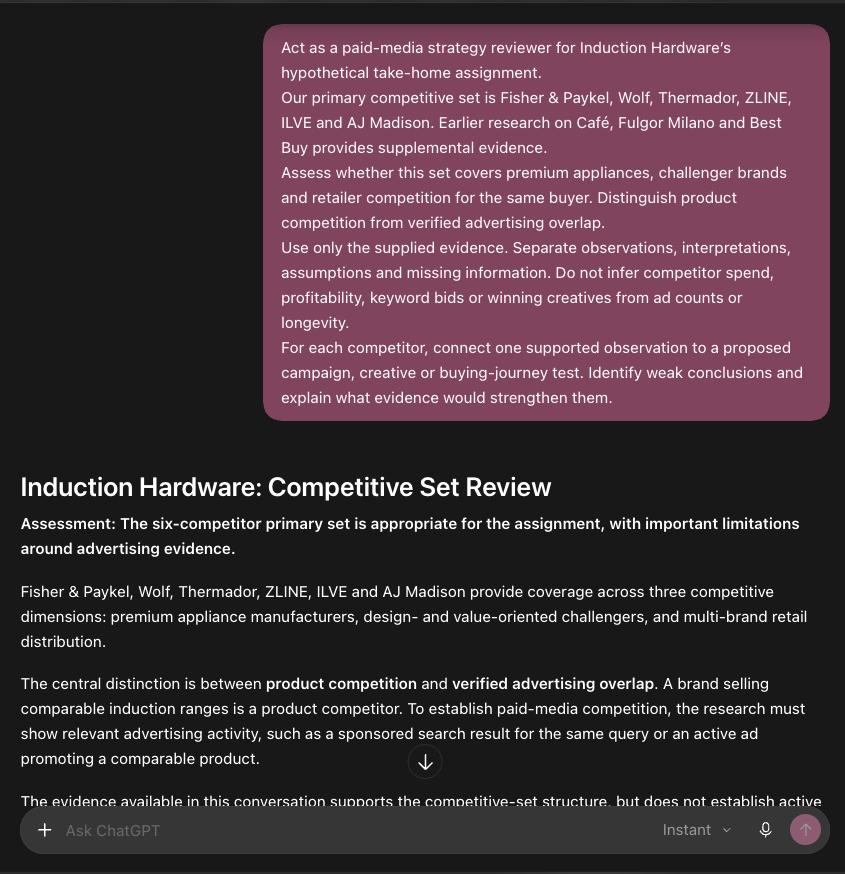

What I kept: the six-company set and the distinction between a comparable product and verified advertising overlap. I would ask for stronger query evidence before describing an auction threat.

## AI-REVIEW-002. Checking the budget and pacing

ChatGPT post-draft review | user-supplied capture dated 26 October 2026

The visible response confirms the phase totals, questions the peak spending jump and notes the contribution shortfall. These concerns were already disclosed in the plan. The prompt is collapsed and the full answer is not visible.

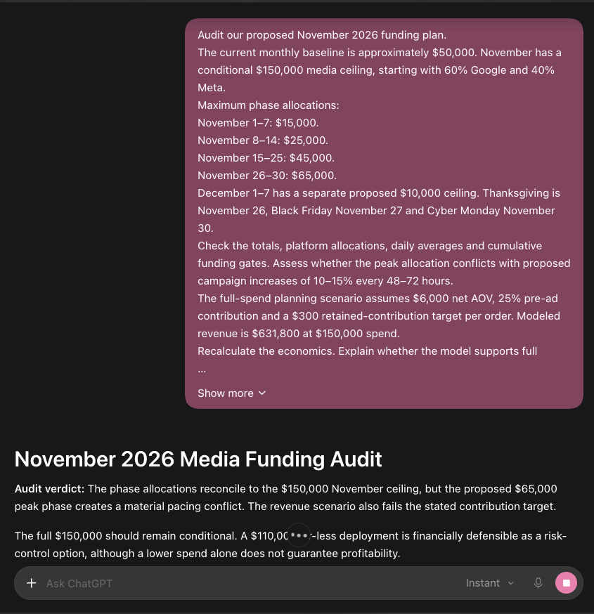

What I kept: the conditional ceiling, a separate December allowance and the warning about the peak jump. The planning forecast still does not justify full release. A lower ceiling does not fix weak unit economics by itself.

## AI-REVIEW-003. Challenging the risk of extra spend

ChatGPT post-draft review | user-supplied capture dated 26 October 2026

The prompt asks ChatGPT to challenge the current strategy without inventing competitor performance or client agreements. The visible response frames profitability, attribution and fulfillment risks. Its title, “Independent Risk Audit”, overstates what the exchange establishes. I changed the description to “AI-assisted post-draft risk review”. The screenshot supplies the actual before wording; no independent audit or full risk ranking is established.

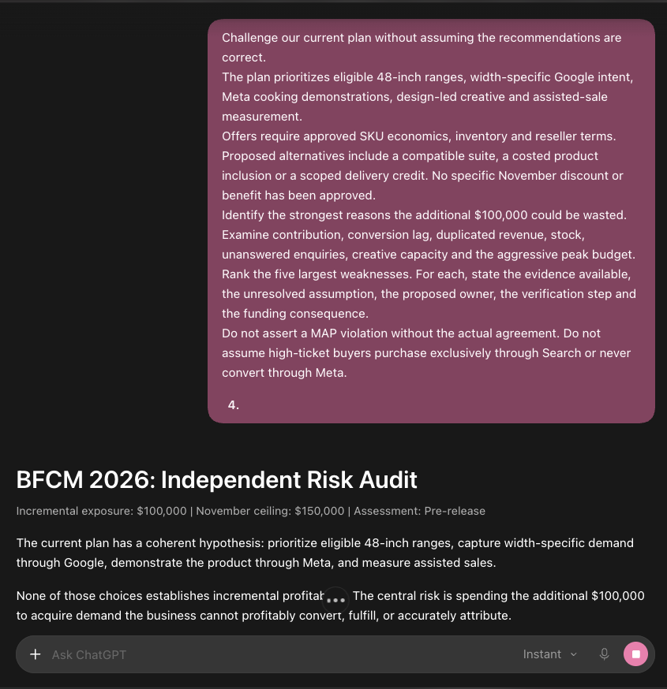

What I changed: the description of this exchange. The screenshot uses Independent Risk Audit. I describe it as an AI-assisted post-draft risk review because no independent audit or new client evidence is established.

## AI-REVIEW-004. Asking for supported revisions

ChatGPT post-draft review | user-supplied capture dated 26 October 2026

The visible response finds no factual error in the budget arithmetic, 60/40 split or conditional ceiling. It raises evidence and execution concerns. The screenshot does not show every proposed revision or a later user decision.

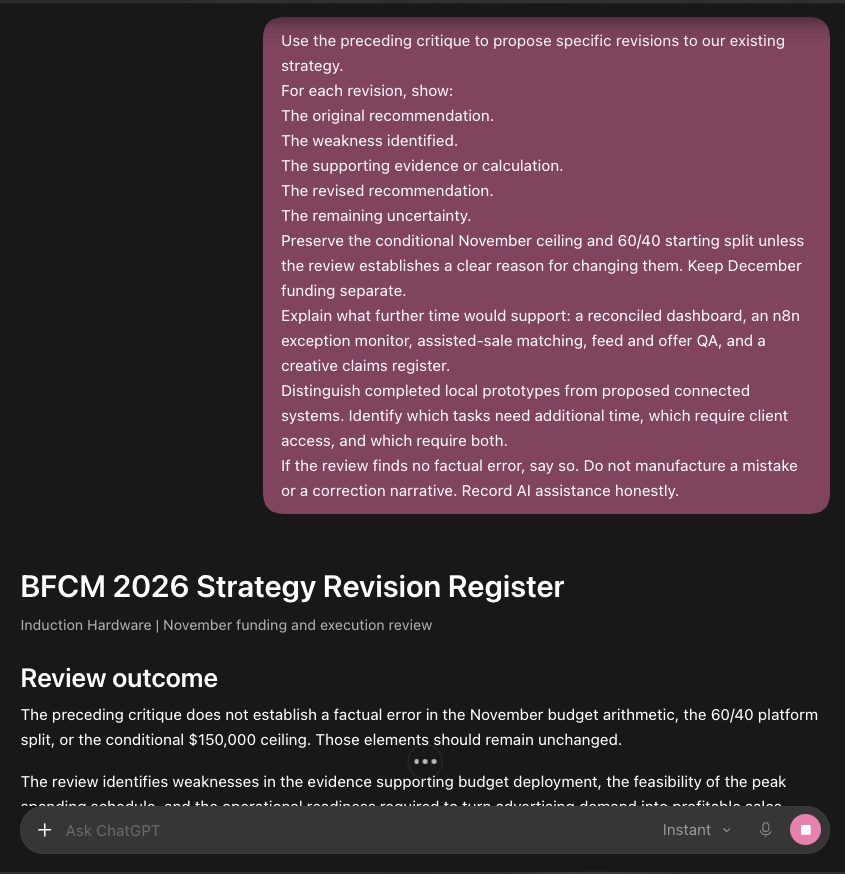

What I kept: the arithmetic and starting split. The practical response is to improve the evidence and operational readiness before funding the peak, rather than invent a numerical error. Section B and the additional-time page explain the proposed builds.

## Appendix and review checklist

One combined review document, editable source and original evidence. The report, review website and evidence travel together.

Item | Location or status
--- | ---
Editable report | deliverables/Induction_Hardware_Complete_Review.md
Current research and strategy | research/ and strategy/ CSVs
Combined evidence gallery | deliverables/evidence-gallery.html
Original screenshots | evidence/screenshots/ and evidence/codex-original/part-1/evidence/
Original Codex evidence and prompt records | evidence/codex-original/part-1/
Preserved reference PDFs | sources/Part_1_original.pdf and sources/Part_2_original.pdf. Later attachment also preserved.
Original complete project | Package root originals/Projects_original.zip
Local automation and blueprint | automation/python/ and automation/n8n/
Validation and pending items | qa/validation-report.json and qa/review-items.csv
Source preservation manifest | qa/original-preservation.csv
Package hashes | Package root manifest-sha256.csv

I would welcome a challenge to the argument, especially the peak allowance and assumed economics. The source files make those decisions traceable. Before execution, I would recheck live offers, prices, stock and service coverage. Earlier source files stay intact, even where their competitor set differs from this report.

Before submission, I need to review the draft in my own voice and stand behind each decision. The four new screenshots are included as a later AI review. If an image of the original AI error and correction is required, that image remains missing. Controlled US auction work, historical BFCM examples and full video reviews are still research gaps. I would state known elapsed work honestly.
